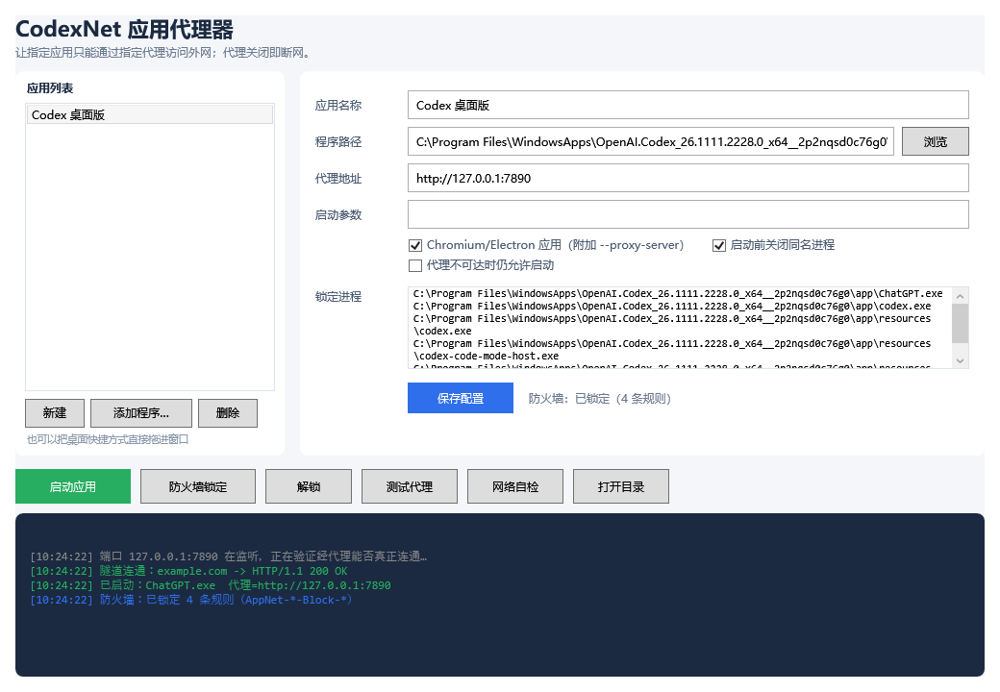

<p align="center"></p>

# CodexNet

**Pin one Windows application to one specific proxy — and make that binding real.**

No TUN adapter · No system-wide proxy change · No kernel driver · No admin install · Pure PowerShell · MIT

[中文说明](README.zh-CN.md) · [How it works](docs/HOW-IT-WORKS.md) · [Comparison with existing tools](docs/COMPARISON.md) · [Publishing guide](docs/PUBLISHING.md)



---

## The problem

You run a local proxy client (Clash / mihomo / v2rayN / a corporate HTTP proxy) listening on
`127.0.0.1:7890`. You want **one** application — say the ChatGPT / Codex desktop app — to go through
it, while your browser keeps using the direct line, and while that app **cannot slip out sideways**.

Windows gives you only bad options out of the box:

| Naive approach | Why it fails |
| --- | --- |
| Set the system proxy | Per-user, not per-app. Your browser goes through the proxy too. |
| Turn on TUN mode | Hides every app behind one adapter; routing rules become a second project. |
| Add an `HTTP_PROXY` env var | Many apps ignore it; nothing stops a direct connection. |
| Install a WFP/kernel driver proxifier | Works, but needs a signed driver, admin install and a reboot-grade blast radius. |

CodexNet takes the cheap path that is still honest: **launch the app with proxy settings it actually
respects, then remove every other way out with Windows Firewall.** If the proxy is not actually
usable, the launcher refuses to start the app at all.

---

## What you get

| | |
| --- | --- |
| **Per-app profiles** | Any number of `app ↔ proxy` pairs in `profiles.json`, edited through a small WPF GUI |
| **Launch binding** | `--proxy-server` for Chromium/Electron apps + `HTTP(S)_PROXY / ALL_PROXY` for everything else |
| **Optional firewall lock** | Per-exe outbound block outside `127.0.0.0/8` — proxy or nothing |
| **Tunnel probe** | Proves the proxy can *actually* forward (a listening port is not a working proxy) |
| **Leak self-check** | Samples the app's live TCP sockets and flags anything that is not the proxy |
| **Zero residue** | Env vars live inside the launcher process; firewall rules are named and removable |

---

## Quick start

```text
1. Start your proxy client (press 扫描 in the app if you are unsure of the port).
2. Double-click  CodexNet.exe          (single file, nothing to unzip)
3. Pick the profile → 测试代理 (test) → 启动应用 (launch) → 网络自检 (self-check)
4. Optional: 防火墙锁定 (firewall lock) — one UAC prompt, fully reversible with 解锁
```

Adding another app: **drag its desktop shortcut onto the window**, or press 添加程序… and pick it.
The real executable, the Chromium/Electron decision and the lock list are all filled in for you —
no path typing.

### Proxy compatibility

| Form | Support |
| --- | --- |
| HTTP proxy (Clash 7890, Clash Verge 7897, v2rayN 10809…) | any `http://127.0.0.1:<port>` |
| SOCKS5 (7891 / 1080 / 10808 / 2080…) | any `socks5://127.0.0.1:<port>`, pre-flight is a real SOCKS5 handshake |
| Clash "mixed" port | both dialects on one port; the scanner classifies it as HTTP first |
| Windows system proxy | the scanner adds whatever the registry points at |
| TUN mode | routing is already global — use `PROCESS-NAME` rules in the client instead |

Command line, if you prefer:

```bat
codex-net.cmd -Restart                  :: launch the app bound to the proxy
codex-net-test.cmd                      :: sample sockets, report LEAK
codex-net-lock.cmd                      :: firewall lock (needs admin, self-elevates)
codex-net-lock.cmd -Unlock              :: remove the rules
codex-net.cmd -DryRun                   :: show what would happen
```

Requirements: **Windows 10/11 + PowerShell 5.1** (preinstalled). Nothing to compile, nothing to install.
Administrator rights are needed **only** for the optional firewall lock.

---

## How it works

Three independent layers; the first two are free, the third is the seatbelt.

| Layer | Mechanism | Covers |
| --- | --- | --- |
| ① Chromium | `--proxy-server=http://127.0.0.1:7890` | Electron/Chromium network stack, renderers, WebSockets, updater. DNS is resolved by the proxy (no local DNS leak). |
| ② Environment | `HTTP_PROXY` `HTTPS_PROXY` `ALL_PROXY` (+ lowercase), `NO_PROXY=localhost,127.0.0.1,::1` | Native clients, Rust/Go cores, child processes that inherit the environment |
| ③ Firewall | Outbound block for the listed `.exe`s on every address outside `127.0.0.0/8`, all protocols | Direct connections that ignore proxy settings, QUIC/UDP bypass, LAN roaming |

Windows Firewall does not filter loopback, so `127.0.0.1:<proxy port>` always stays reachable —
that is what lets layer ③ exist without breaking the proxy itself.

More detail, including the tunnel-probe rationale and the exact firewall ranges:
[docs/HOW-IT-WORKS.md](docs/HOW-IT-WORKS.md).

---

## Honest limitations

* **Apps that ignore both proxy mechanisms cannot be forced through a proxy by this tool.**
  Layer ③ will simply cut them off. For packet-level proxying of arbitrary apps, use a
  WinDivert/NDIS-based proxifier — see [docs/COMPARISON.md](docs/COMPARISON.md).
* **Child processes are not covered by firewall rules.** Rules are per-executable. A shell command
  spawned by the app inherits the proxy environment, but an explicit `--noproxy` call can still go direct.
* **Electron apps are single-instance.** Without `-Restart` the old process is reused and the new
  proxy arguments never reach it.
* **App updates move the executable.** Windows Store packages change folder names on upgrade
  (`…Codex_26.1103…` → `…Codex_26.1111…`). The GUI rewrites the profile path on startup when it notices
  the old one is gone, and re-locking prunes rules that point at the vanished path.
* **IPv4 only** in the firewall rules (all addresses except `127.0.0.0/8`).
* It does not hide traffic from a network administrator; it only makes the routing deterministic.

---

## Repository layout

```text
CodexNet-GUI.ps1        WPF GUI (profiles, launch, lock, probe, self-check)
CodexNet.vbs            silent launcher for the GUI
codex-net-gui.cmd       console launcher (debugging)
Start-CodexNet.ps1      CLI launcher, env + Chromium flag + tunnel probe
Test-CodexNet.ps1       CLI socket sampler / leak report
Lock-AppNet.ps1         generic firewall lock (Lock / Unlock / Status)
Lock-CodexNet.ps1       Codex-specific preset
profiles.example.json   profile schema example
install-gui-shortcut.ps1 / install-shortcut.ps1   shortcut creators
docs/                   how it works, comparison, publishing
assets/                 logo: PNG sizes, SVG, multi-size ICO
```

---

## Where the name comes from

It was written for the Codex / ChatGPT desktop app (an Electron shell around a Rust core), which is
why the default profile and the preset lock list target it. The mechanism is generic: any Windows
executable that honours a proxy environment variable or a Chromium proxy switch can be pinned the
same way.

---

## License

[MIT](LICENSE). Do whatever you want, no warranty.
