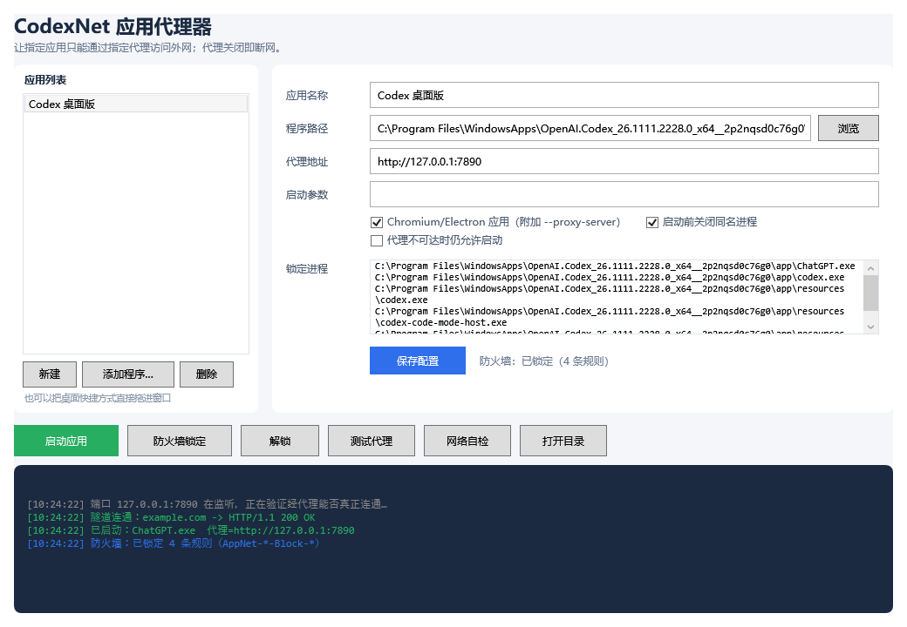

<p align="center"></p>

# CodexNet

**把一个 Windows 应用钉死在一条代理上 —— 而且是真钉死。**

不建 TUN 网卡 · 不改系统代理 · 不装内核驱动 · 不用安装 · 纯 PowerShell · MIT

[English](README.md) · [实现原理](docs/HOW-IT-WORKS.md) · [与现成方案对比](docs/COMPARISON.md) · [发布到 GitHub](docs/PUBLISHING.md)



---

## 要解决的问题

本机有个代理客户端（Clash / mihomo / v2rayN / 公司 HTTP 代理）在 `127.0.0.1:7890` 上监听。
你希望**只有某一个应用**——比如 ChatGPT / Codex 桌面版——走它，浏览器继续走直连线路，
而且那个应用**没有别的路可以溜出去**。

Windows 自带的路子都不好用：

| 常见做法 | 问题 |
| --- | --- |
| 开系统代理 | 按用户生效，不按进程。浏览器也一起被代理了。 |
| 开 TUN 模式 | 全机流量塞进一张虚拟网卡，分流规则变成第二个工程。 |
| 只加 `HTTP_PROXY` 环境变量 | 很多应用根本不看；也拦不住它直连。 |
| 装 WFP/内核驱动的 proxifier | 能用，但要签名驱动、管理员安装，出问题的爆炸半径很大。 |

CodexNet 走的是便宜但不撒谎的路线：**用它真正认的代理设置启动应用，再用防火墙把其余出口全部掐掉。**
代理不可用时，启动器直接拒绝启动。

---

## 能做什么

| | |
| --- | --- |
| **按应用分档案** | `profiles.json` 里存任意多组「应用 ↔ 代理」，用一个小 WPF 界面编辑 |
| **快捷方式即添加** | 把桌面快捷方式拖进窗口，或点「添加程序…」选它 —— 自动解析真实 exe、识别 Chromium、生成锁定清单 |
| **启动即绑定** | Chromium/Electron 应用追加 `--proxy-server`；其它应用注入 `HTTP(S)_PROXY` / `ALL_PROXY` |
| **可选防火墙锁** | 按 exe 阻断 `127.0.0.0/8` 之外的全部出站 —— 要么走代理，要么没网 |
| **隧道实测** | 证明代理**真的能转发**（端口在听 ≠ 代理可用） |
| **泄漏自检** | 采样应用的真实 TCP 连接，标出任何不是代理的连接 |
| **无残留** | 环境变量只活在启动器进程里；防火墙规则有名字、可一键删除 |

---

## 三步上手

```text
1. 启动代理客户端（不确定端口就点界面里的「扫描」）
2. 双击  CodexNet.exe      （单文件，免解压、免装 PowerShell 脚本）
3. 选中档案 → 测试代理 → 启动应用 → 网络自检
4. 可选：防火墙锁定（弹一次 UAC），点「解锁」完全回滚
```

要加别的应用：把桌面快捷方式**拖进窗口**，或点「添加程序…」选它 —— 路径、Chromium 判定、锁定清单都会自动填好，不用手打路径。

### 兼容不同代理

| 形态 | 支持 |
| --- | --- |
| HTTP 代理（Clash 7890、Clash Verge 7897、v2rayN 10809…） | ✅ 填 `http://127.0.0.1:端口` |
| SOCKS5（7891 / 1080 / 10808 / 2080…） | ✅ 填 `socks5://127.0.0.1:端口`，启动前用 SOCKS5 握手实测 |
| Clash 的「混合端口」 | ✅ 同一端口两种协议都通，扫描时优先按 HTTP 识别 |
| 系统代理（注册表里已设置的） | ✅ 扫描会把它列成「系统代理」候选 |
| TUN 模式 | ⚠️ 全机流量已被接管，本工具的绑定意义不大，改用客户端内的 `PROCESS-NAME` 规则 |

想用命令行：

```bat
codex-net.cmd -Restart                  :: 带代理绑定重启应用
codex-net-test.cmd                      :: 采样连接，报告 LEAK
codex-net-lock.cmd                      :: 防火墙锁定（自动提权）
codex-net-lock.cmd -Unlock              :: 删除规则
codex-net.cmd -DryRun                   :: 只打印将要做什么
```

依赖：**Windows 10/11 + PowerShell 5.1**（系统自带），不需要编译、不需要安装。
**只有**可选的防火墙锁需要管理员权限。

---

## 三层锁

| 层 | 机制 | 管住什么 |
| --- | --- | --- |
| ① Chromium 层 | 启动参数 `--proxy-server=http://127.0.0.1:7890` | Electron/Chromium 网络栈、渲染进程、WebSocket、自动更新；DNS 由代理远端解析，不回落到本机 |
| ② 环境变量层 | `HTTP_PROXY` `HTTPS_PROXY` `ALL_PROXY`（含小写），`NO_PROXY=localhost,127.0.0.1,::1` | 原生客户端、Rust/Go 内核、继承环境的子进程 |
| ③ 防火墙层 | 对清单里的 exe 阻断 `127.0.0.0/8` 之外的所有地址（全协议） | 无视代理设置的直连、QUIC/UDP 绕过、内网漫游 |

Windows 防火墙不过滤回环流量，所以 `127.0.0.1:<代理端口>` 永远可达 —— 第③层才能既掐死公网又不弄死代理本身。

细节（隧道实测的原因、防火墙地址段的写法）见 [docs/HOW-IT-WORKS.md](docs/HOW-IT-WORKS.md)。

---

## 老实说的限制

* **两种代理机制都不认的应用，这个工具没法把它塞进代理。** 第③层只会把它彻底断网。
  要给任意应用做包级代理，请用 WinDivert/NDIS 类工具 —— 见 [docs/COMPARISON.md](docs/COMPARISON.md)。
* **防火墙规则管不到子进程。** 规则按 exe 生效。应用里跑的命令会继承代理环境变量，但显式
  `--noproxy` 仍可能直连。
* **Electron 应用是单实例的。** 不带 `-Restart` 会复用旧进程，新的代理参数根本进不去。
* **应用升级会换路径。** Windows Store 包升级后目录名会变（`…Codex_26.1103…` → `…Codex_26.1111…`）。
  GUI 启动时若发现旧路径已消失，会自动改写档案；下次点「防火墙锁定」时会顺便清理指向旧路径的规则。
* **防火墙规则只覆盖 IPv4**（`127.0.0.0/8` 之外的全部地址）。
* 它不隐藏流量，只是让路由变得确定。

---

## 仓库结构

```text
CodexNet-GUI.ps1        WPF 界面（档案、启动、锁定、探测、自检）
CodexNet.vbs            无窗口启动 GUI
codex-net-gui.cmd       带控制台的启动方式（排查用）
Start-CodexNet.ps1      命令行启动器：环境变量 + Chromium 参数 + 隧道实测
Test-CodexNet.ps1       命令行自检：采样连接并报告泄漏
Lock-AppNet.ps1         通用防火墙锁定（Lock / Unlock / Status）
Lock-CodexNet.ps1       Codex 专用预设
profiles.example.json   档案格式示例
install-gui-shortcut.ps1 / install-shortcut.ps1   快捷方式生成
docs/                   原理、对比、发布指南
assets/                 logo（多种 PNG、SVG、多尺寸 ICO）
```

---

## 名字的由来

最早是为 Codex / ChatGPT 桌面版写的（Electron 外壳 + Rust 内核），所以默认档案和预置锁定清单都指向它。
机制本身是通用的：任何认代理环境变量、或认 Chromium 代理开关的 Windows 程序，都能用同样方式钉住。

---

## 许可证

[MIT](LICENSE)。随便用，不提供任何担保。
